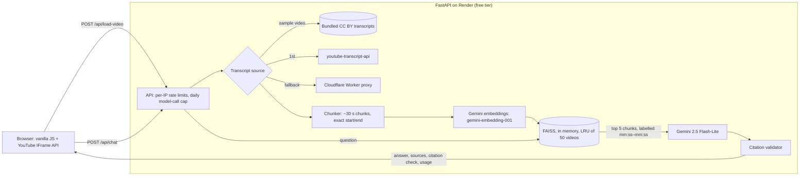

# YouTube Chat AI

Ask a YouTube video a question and get a short answer drawn only from its transcript, with timestamps you can click to jump to the moment that supports each claim. The interesting part is not the chat; it's making the citations trustworthy and the cost visible. The model only ever sees transcript chunks labelled with their real time ranges, the server deletes any cited timestamp that doesn't fall inside a chunk it retrieved, and every answer reports its tokens, list-price cost and latency. It's a small, honest RAG system you can reason about end to end: one video at a time, one cheap model, an eval you can rerun.

**Live:** [akhilrajs.com/youtube-chat](https://akhilrajs.com/youtube-chat/) (frontend lives in the website repo; the server sleeps when idle, so the first request can take up to a minute).

## Architecture



**Load a video.** Get the captions (bundled for the three samples, otherwise `youtube-transcript-api`, then the Worker in `transcript-worker/` when YouTube blocks the server's IP). Merge caption segments into ~500-character chunks (about 30 seconds of speech) that keep the exact start and end of the segments inside them, embed them, and keep a FAISS index in memory. Titles come from YouTube's oEmbed endpoint.

**Ask a question.** Retrieve the 5 nearest chunks, sort them by time, and show them to the model as `[01:05–01:32] text`. The system prompt says: answer only from the excerpts, cite the start time of the excerpt you used, never invent a time, and reply with a fixed sentence when the transcript doesn't cover the question. After generation, every bracketed timestamp in the answer is parsed and kept only if it lies inside the range of a retrieved chunk. The response carries the cleaned answer, the retrieved chunks as structured sources (`start_seconds`, `end_seconds`, `snippet`, `cited`), what the validator removed, and usage (`input_tokens`, `output_tokens`, `cost_usd`, `latency_ms`, `model`).

**In the browser.** Answers are rendered with `marked`, sanitised with DOMPurify, and timestamps become buttons that call `player.seekTo(seconds, true)` on the embedded player (no iframe reloads). Each answer shows a line like `1,240 in · 96 out · $0.00016 · 1.1 s`, and a running session total.

## Design decisions and trade-offs

| Decision | Why | Cost of the choice |
| --- | --- | --- |
| **Timestamps are data, not model output.** Chunks are labelled with real time ranges and cited times are validated after generation. | The earlier version passed chunk text without times, so every `[MM:SS]` the model wrote was a guess. Grounding plus validation makes a clickable timestamp a verifiable claim. | The validator checks that a cited time is inside a retrieved chunk, not that the chunk supports the specific sentence. That second question is what the eval's faithfulness judge measures. |
| **~500-character chunks (≈30 s), 1-segment overlap, no secondary text splitter.** | Short chunks give precise citations; the overlap avoids cutting a sentence's context at a boundary. A generic splitter would leave two halves claiming the same time range. | Answers that need a long stretch of argument can miss context. Configurable with `CHUNK_TARGET_CHARS`. |
| **k = 5.** | About 2,500 characters of context (~2.5 minutes of speech): enough for most factual questions on short and medium videos, keeps input near 1,000 tokens. | "Summarise this 1-hour video" sees ~4% of it and will be incomplete. Fixing that needs a different path (map-reduce summary), not a bigger k. |
| **Gemini 2.5 Flash-Lite** for answers. | The task is extractive QA over ~1,000 tokens of context; the cheapest Flash-Lite model on Google's price list is enough. List prices on 29 Oct 2026: 2.5 Flash-Lite $0.10 in / $0.40 out per 1M tokens, 3.1 Flash-Lite $0.25 / $1.50, 2.5 Flash $0.30 / $2.50 ([source](https://ai.google.dev/gemini-api/docs/pricing)). | A stronger model may refuse more accurately and paraphrase better. Swapping is one env var (`CHAT_MODEL`); the eval is the way to decide. |
| **`gemini-embedding-001`** with retrieval task types. | $0.15 per 1M tokens; a 5-minute video costs about $0.0002 to index. | The embeddings API doesn't return token counts, so indexing cost is estimated at 4 characters per token and labelled as an estimate. |
| **In-memory index, no database.** | Zero infrastructure on a free tier; re-indexing a short video takes seconds. | A restart drops every index. The UI notices (`VIDEO_NOT_LOADED`), re-loads the video and retries once. The samples are bundled and pre-indexed at startup. |
| **Cost is reported per answer.** | Gemini returns `usage_metadata`; tokens × list price from `app/pricing.py` (dated, sourced, env-overridable). | List price, not the bill: the demo may run on the free tier. |

**Cost per answer.** A typical prompt is about 950 input tokens (system prompt + 5 chunks + question) and answers run about 100 output tokens: roughly $0.00014 at list price, or ~7,000 answers per dollar. `DAILY_LLM_CAP=500` bounds a day of answers to about $0.07. The worst case (every capped call indexing a maximum-length 300,000-character transcript) is about $6/day.

## Evals

`backend/evals/run_eval.py` runs 15 questions over the three sample videos (`evals/questions.json`; 4 of them are deliberately not answerable from the transcript) through the same `RAGService` the API uses, and writes `evals/results.json`.

| Metric | What it measures | Result |
| --- | --- | --- |
| Citation validity | Share of timestamps the model cited, *before* post-validation, that fall inside a retrieved chunk | not yet run |
| Answers with a citation | Share of answered (non-refused) answerable questions with at least one valid citation | not yet run |
| Refusal accuracy | Share of unanswerable questions the model declined | not yet run |
| False refusals | Share of answerable questions it wrongly declined | not yet run |
| Faithfulness | Share of non-refusal answers an LLM judge rates fully supported by the retrieved excerpts | not yet run |
| Latency p50 / p95 | Server-side retrieval + generation | not yet run |
| Mean cost per answer | List price, from reported token usage | not yet run |

The live eval needs a Gemini API key and makes about 30 generation calls (answers + judge) plus 3 index builds, under $0.01. It hasn't been run for this revision because no key was available where it was written; the plumbing is checked with `python evals/run_eval.py --offline` (fake models, nothing written). The judge defaults to the answer model (`EVAL_JUDGE_MODEL` to use a stronger one); a model grading itself is lenient, so treat faithfulness as an upper bound. Fifteen questions are a smoke test, not a benchmark.

## Limitations

- Transcript only: nothing from visuals or audio. Videos without captions can't be used, and YouTube often blocks cloud IPs, which is why the Worker fallback and the bundled samples exist.
- Retrieval-only answers; whole-video summaries of long videos will be incomplete (see k above).
- Citation validation is range-based: it proves a cited time was in the model's context, not that the sentence is entailed by it.
- State is per process and in memory: rate limits, the daily cap and the video cache reset on restart and aren't shared across instances. Fine for one free-tier instance, not for scale.
- Rate limiting trusts `CF-Connecting-IP` / `X-Forwarded-For`; a client that reaches the server without going through the proxy can spoof them. The global daily cap is the real spend backstop.
- No user accounts or persistence; conversation history (last 6 turns) lives in the browser and is sent with each question.
- `transcript-worker/` is a best-effort fallback and is not authenticated.

## Run locally

```bash
cd backend
python3.11 -m venv .venv && source .venv/bin/activate
pip install -r requirements-dev.txt
cp .env.example .env          # add GOOGLE_API_KEY from https://aistudio.google.com/apikey
uvicorn app.main:app --reload --port 8000
```

Frontend (in the website repo, `youtube-chat/`): serve the folder with `python3 -m http.server 8080` and open `http://localhost:8080/?api=http://localhost:8000`. The `api` parameter only accepts localhost, 127.0.0.1 or the production API; on localhost it defaults to `http://localhost:8000`.

**Tests** (no network or API key needed; the LLM and embeddings are faked):

```bash
cd backend && pytest
```

They cover video-ID extraction, chunk building and time ranges, timestamp formatting/parsing and citation validation, cost maths and price overrides, the rate-limit key and daily cap, and the API end to end (CORS, friendly errors, no leaked exception text, structured sources and usage).

**Evals:** `cd backend && python evals/run_eval.py` (live) or `--offline`.

## API

| Endpoint | Purpose |
| --- | --- |
| `GET /health` (also `HEAD`, `/`) | Liveness, number of cached videos, whether the samples are indexed |
| `POST /api/load-video` `{"url"}` | Fetch, chunk and index a video. Returns `title`, `channel`, `duration_seconds`, `chunk_count`, `is_sample`, `usage` (estimated embedding tokens and cost) |
| `POST /api/chat` `{"video_id", "question", "chat_history"}` | Returns `answer`, `refused`, `sources[]`, `citation_check` (`cited`, `valid`, `removed`), `usage` |

Errors are `{"detail": "<user-facing message>", "code": "<CODE>"}`: `INVALID_INPUT`, `TRANSCRIPT_UNAVAILABLE`, `VIDEO_TOO_LONG`, `VIDEO_NOT_LOADED`, `RATE_LIMITED`, `DAILY_CAP`, `MODEL_BUSY`, `MODEL_ERROR`, `TIMEOUT`, `INTERNAL`. Exception details are logged server-side only.

## Configuration and deploy

`render.yaml` (repo root, `rootDir: backend`) defines the service. Environment variables (see `backend/.env.example`):

| Variable | Default | Notes |
| --- | --- | --- |
| `GOOGLE_API_KEY` | (none) | Required |
| `ALLOWED_ORIGINS` | `https://akhilrajs.com` | Exact CORS origins; `http://localhost:*` and `http://127.0.0.1:*` are always allowed; no credentials |
| `DAILY_LLM_CAP` | `500` | Model calls (answers + new-video indexing) per UTC day; returns a friendly 429 |
| `LOAD_RATE_LIMIT` / `CHAT_RATE_LIMIT` | `10/minute` / `20/minute` | Per client IP |
| `MAX_TRANSCRIPT_CHARS` | `300000` | Rejects very long videos |
| `RETRIEVAL_K`, `CHUNK_TARGET_CHARS`, `MAX_VIDEOS_CACHED` | `5`, `500`, `50` | Retrieval knobs |
| `CHAT_MODEL`, `EMBEDDING_MODEL` | `gemini-2.5-flash-lite`, `gemini-embedding-001` | Prices in `app/pricing.py`, overridable via `PRICE_<MODEL>_INPUT/_OUTPUT` |
| `PRELOAD_SAMPLES` | `1` | Index the bundled samples at startup |
| `TRANSCRIPT_WORKER_URL` | the deployed Worker | Fallback transcript proxy |

The start command runs uvicorn with `--proxy-headers --forwarded-allow-ips '*'` so client addresses survive Render's proxy.

## Repository layout

```
backend/
  app/
    main.py            FastAPI app, CORS, error handlers, sample preload
    limiter.py         client-IP key, per-IP limits, global daily cap
    pricing.py         model list prices (dated, sourced), cost maths
    errors.py          user-facing error responses
    routers/chat.py    /api/load-video, /api/chat
    services/          transcript fetching, chunking, citations, RAG, samples
    samples/           bundled transcripts of the three CC BY sample videos
  evals/               run_eval.py, questions.json, results.json (after a live run)
  tests/               pytest suite (offline)
transcript-worker/     Cloudflare Worker that fetches captions when YouTube blocks the server
chrome-extension/      Experimental Manifest V3 sidebar for youtube.com (load unpacked)
android-app/           Experimental WebView wrapper (not published)
```

The Chrome extension's content script calls the API from `https://www.youtube.com`, so it only works against a backend whose `ALLOWED_ORIGINS` includes that origin.

## Sample videos and attribution

The three sample videos are published on YouTube under the Creative Commons Attribution licence ("Creative Commons Attribution license (reuse allowed)" on each watch page, checked 29 Oct 2026). Their English captions, as published by the creators, are redistributed in `backend/app/samples/` with whitespace normalised and no other changes.

- [How Google Search Works (in 5 minutes)](https://www.youtube.com/watch?v=0eKVizvYSUQ), Google
- [What is a neural network? A computer scientist explains.](https://www.youtube.com/watch?v=GqAw9OpuE9c), The Conversation (Prof. Tam Nguyen, University of Dayton)
- [How a lead-acid battery works](https://www.youtube.com/watch?v=rhIRD5YVNbs), engineerguy (Bill Hammack)

## License

MIT
